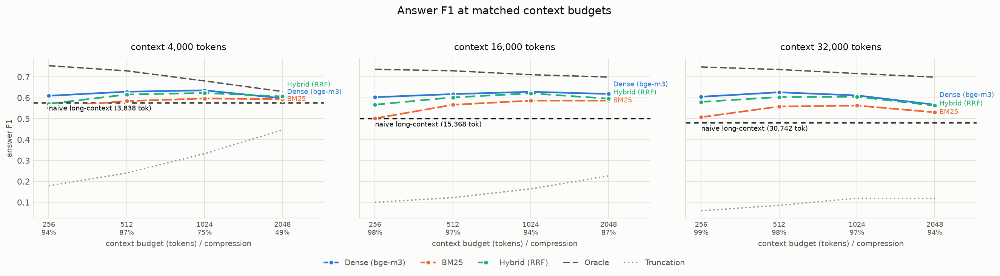

# Retrieval-Head-Guided Efficient Long-Context RAG

Standard RAG decides what to put in the context window with an *external* signal:
embedding similarity between the query and candidate chunks. This project uses an
*internal* one — the attention of the specific heads that empirically do the
copy-from-context work inside the generator itself — to decide what to keep and
how far to compress a long context.

The headline question: **at a matched context budget, does selecting context with
the model's own retrieval heads beat selecting it with a dense retriever?**

## Method

Three systems are compared at matched context budgets on multi-hop QA:

| System | Context selection signal |
|---|---|
| Naive long-context | none — everything in the window |
| Dense-retrieval RAG | external embedding similarity |
| Retrieval-head-guided (ours) | internal attention from identified retrieval heads |

## Stage 1 — Retrieval-head identification

Reimplements the retrieval score from Wu et al., *Retrieval Head Mechanistically
Explains Long-Context Factuality*.

A needle sentence is planted at a known depth in a long distractor context (Paul
Graham essays) and the model is asked a question only the needle answers. At each
decode step, a head scores a hit if its attention **argmax** lands on a needle
token that is exactly the token being generated — the head caught copying.

The headline metric is **copy-precision**: of the decode steps where the emitted
token was in the needle, the fraction where the head's argmax pointed at it.
Wu et al.'s `|g_h| / |k|` is reported alongside it.

### Why not the published normalizer as headline

`|g_h| / |k|` divides by the *whole needle*, but the model only copies the
*answer span*. On a 26-token needle whose answer is ~10 tokens, a head copying
perfectly cannot score above 0.371. In the first sweep this made retrieval heads
look like they collapsed on rare proper nouns (`L15H30`: 0.87 on natural facts
vs 0.28 on a rare name) — a textbook "heads don't generalize" result that was
purely an artifact. That needle's recall was 0.97: the model retrieved it
perfectly.

Dividing each needle's observed score by its achievable ceiling gave a ratio of
0.76–0.89 across all eight needles — uniform once the ceiling was accounted for.
Under copy-precision, which is invariant to answer-span length, `L15H30` scores
0.800–0.918 on every needle.

Scores are broken out per individual needle as well as per needle kind: a kind
holding a single needle is confounded with that needle's identity, which is how
the artifact disguised itself.

### Result

**25 of 1024 heads score above 0.1**, and the signal is sparse and concentrated:

| rank | head | copy-precision | Wu et al. score |
|---|---|---|---|
| 1 | L15H30 | 0.865 | 0.725 |
| 2 | L8H1 | 0.430 | 0.362 |
| 3 | L16H1 | 0.376 | 0.319 |
| 4 | L24H27 | 0.372 | 0.308 |
| 5 | L16H20 | 0.338 | 0.282 |

240 instances (3 context lengths × 10 depths × 8 needles), needle recall 0.988,
154 s on one H200. Recomputing over only the 237 answered instances leaves the
top-20 unchanged (overlap 20/20), so the list is not an artifact of failures.

### Verifying the head list

Wu et al. publish head scores for llama-2-7b-80k, llama-2-13b-64k,
Mistral-7B-v0.2, Mixtral-8x7B, Qwen1.5-14B(-Chat) and Yi-6B-200K — but **not for
any Llama-3.x model**, so there is no published list to reproduce here. Against
llama-2-7b-80k the *shape* matches (2.1% vs 3.2% of heads above 0.1) while the
positions do not (top-20 overlap 1/20, Spearman +0.015) — expected, since
retrieval heads are model-specific.

So the list is verified **causally** instead, the same evidence the original
paper uses. Heads are zeroed at the input to `o_proj`, and random heads of
matched count are masked as a control:

| heads masked | identified | random (3 seeds) | gap |
|---|---|---|---|
| 1 | 0.975 | 0.975 | +0.000 |
| 5 | 0.688 | 0.975 | **+0.287** |
| 10 | 0.625 | 0.962 | **+0.337** |

Masking 5 identified heads costs 29 points of needle recall; masking 5 random
heads costs nothing.

**`L15H30` alone is dispensable.** The top head by a factor of two changes recall
by 0.000 when masked on its own — the capability is redundant across the top few.
The compression mechanism therefore keys on the top-k set (k ≥ 5), not a single
head.

```bash
python -m heads.run_ablation --heads results/head_id/<tag>_retrieval_heads.json
python -m heads.test_masking     # the mask mechanism itself
python -m heads.compare_published --scores results/head_id/<tag>_head_scores.json
```

### Why the score is computed at decode time only

`output_attentions` was removed in transformers 5.x, and attention weights are
only produced by the eager path — SDPA and flash never materialize the matrix.
Running the model eager throughout is not viable: an eager prefill allocates a
`[heads, T, T]` matrix per layer, roughly 4 GB per layer at T=8k, growing
quadratically.

The score only ever reads attention at *decode* steps, where the query length is
1 and the matrix is `[heads, 1, T]` — about 1 MB per layer. Since
`LlamaAttention.forward` re-reads `config._attn_implementation` on every call,
the pipeline prefills under SDPA and flips to eager only for the single-token
steps, capturing weights with a forward hook. The final prompt token is fed
inside the decode loop rather than the prefill, so even the attention producing
the *first* generated token is captured at `q_len=1`.

## Stage 2 — The benchmark and the baselines

### Why HotpotQA is padded rather than used as-is

HotpotQA's distractor setting gives 10 paragraphs — **mean 1,312 Llama tokens,
median 1,283**. Llama-3.1 has a 128k window, so at that length nothing is lost in
the middle, there is nothing to compress, and every method ties. Measuring
long-context compression on it would be measuring nothing.

So each question keeps its 2 gold paragraphs and its 8 hard TF-IDF distractors,
and is padded with paragraphs pooled from *other* questions up to a target
length (4k / 16k / 32k). That buys a context-length knob, exact sentence-level
gold labels, and controllable gold *depth* for the lost-in-the-middle probe.

Pooled paragraphs are excluded by title whenever the title appears anywhere in
the source question's own 10, which prevents re-inserting gold content at an
unlabelled position. The pool is drawn from the **train** split so padding never
pulls another evaluation question's gold paragraph in. The honest caveat: a
pooled paragraph under a different title could still mention the answer. That
risk is inherent to any distractor pool (fullwiki included) and is not corrected
for.

### The unit of retrieval is the sentence

HotpotQA annotates supporting facts per sentence, so making the sentence the
retrieval unit lets Recall be scored directly against the annotation with no
span mapping in between. Sentences are scored title-prefixed (`"<title>:
<sentence>"`) because a bare HotpotQA sentence often drops its subject ("He was
born in…"), which no retriever can recover.

### Matched budget

Budget is **tokens of retrieved context handed to the generator**, excluding the
question and prompt scaffolding. Every method spends it through the same greedy
packer, so a difference in results is a difference in the retrieval signal and
not in how greedily one implementation packed its context. Measured on the
rendered string, the budget binds tightly and is never exceeded (e.g. 1024 →
973 tokens).

### Methods compared

| | signal |
|---|---|
| naive long-context | none — the whole padded context |
| truncation | document order until the budget runs out |
| BM25 | lexical |
| dense (bge-m3) | embedding similarity |
| hybrid | reciprocal-rank fusion of the two |
| oracle | gold sentences first — a ceiling, not a baseline |

BM25 is reported alongside bge-m3 deliberately: multi-hop questions are
entity-heavy, which is exactly where a lexical retriever stays competitive, and
a headline result that only beats a weak retriever is not worth much. The oracle
says how much of the remaining error is retrieval failure versus the generator
failing on a context that already contains the answer.

Exact search is used rather than a FAISS index — each instance has its own
haystack of a few hundred to a few thousand sentences, so one matmul is both
exact and faster than building a per-instance ANN index. An index only earns its
cost against a single large shared corpus, which is not this setting.

```bash
python -m data.test_hotpot        # 18 construction checks, offline, seconds
python -m baselines.run_baselines --n 300 --context-lengths 4000 16000 32000 \
    --budgets 256 512 1024 2048
python -m baselines.run_latency   # unbatched latency vs naive long-context
python -m eval.plot --summary results/baselines/<tag>_baselines_summary.json
```

### Results — 300 questions, 3 context lengths, 4 budgets



**Retrieval beats stuffing the window, and the gap widens with length.** At a
256-token budget — 1/128th of a 32k context — dense retrieval scores higher than
feeding the model everything:

| context | naive long-context F1 | dense @256 F1 | Δ | compression |
|---|---|---|---|---|
| 4,000 | 0.576 | 0.610 | +0.034 | 93.8% |
| 16,000 | 0.500 | 0.603 | +0.103 | 98.4% |
| 32,000 | 0.480 | 0.605 | +0.125 | 99.2% |

Naive long-context decays as the context grows (0.576 → 0.500 → 0.480) while
dense retrieval is essentially flat (0.610 → 0.603 → 0.605). The decay *is*
lost-in-the-middle: the gold sentences are always present in the naive
condition, so nothing was lost to retrieval — only to the model's ability to use
a long context.

**More context hurts even when the evidence is guaranteed present.** The oracle
condition always contains every gold sentence, and its F1 still *falls* as the
budget grows — 0.753 → 0.729 → 0.680 → 0.630 at 4k across 256 → 2048 tokens. The
only thing changing is how much non-gold text sits alongside the answer. This is
the cleanest evidence in the run that compression is worth doing at all, and it
is why every method peaks at 256–1024 rather than at the largest budget.

**The headroom that justifies the rest of the project.** Dense retrieval reaches
0.605 F1 at 32k/256; the oracle reaches 0.747 at the same budget. That **~0.14 F1
gap is not a generation limit — it is a retrieval-signal limit**, and it is
exactly the gap the retrieval-head method has to attack. The bar for Stage 3 is
therefore dense retrieval, not naive long-context.

BM25 is a real baseline rather than a strawman (0.555 F1 at 4k/256, within 0.055
of dense) but loses at every budget and length. Hybrid RRF lands between the two
and never beats dense alone — fusing a weaker lexical signal into a stronger
dense one costs more than it adds here. Truncation collapses with length (0.179
→ 0.100 → 0.059 at a 256-token budget), confirming the padded haystack really
does bury the evidence rather than leaving it near the front.

### Latency

Unbatched, one request at a time, 10 warm-up calls discarded, 25 questions per
length. Jobs are shuffled across conditions — grouped by length, whichever block
ran first absorbed the residual warm-up and read 196 ms against 77 ms elsewhere
for an identically sized prompt.

| context | naive | dense @256 | speedup |
|---|---|---|---|
| 4,000 | 235 ms | 108 ms | 2.2× |
| 16,000 | 644 ms | 110 ms | 5.8× |
| 32,000 | 1,381 ms | 92 ms | **15.0×** |

So at 32k the retrieval baseline is simultaneously **more accurate (+0.125 F1)
and 15× faster** than reading the whole context.

## Layout

```
data/        pooled-distractor HotpotQA construction, budget packing
heads/       retrieval-head identification (needles, haystack, capture, scoring)
baselines/   dense-retrieval RAG, BM25, naive long-context
compress/    retrieval-head-guided context compression
eval/        Recall@k, QA accuracy/F1, figures
results/
```

## A note on model loading on this box

The HF cache lives on NFS, and transformers materializes checkpoint tensors
through an mmap. Sequential reads off that mount run at ~80 MB/s but mmap
page-faults do not: **bge-m3 did not finish loading in 280 s from the cache, and
loads in 30 s from local disk.** `paths.resolve_model` therefore prefers a local
mirror under `/data/jayavardhan/lcrag_models/` and falls back to the HF id.

## Setup

```bash
conda create -p /mnt/warm_storage/jayavardhan/tools/conda-envs/lcrag python=3.11
/mnt/warm_storage/jayavardhan/tools/conda-envs/lcrag/bin/pip install \
    torch transformers accelerate datasets sentencepiece protobuf \
    numpy pandas matplotlib tqdm huggingface_hub hf_transfer
```

Run head identification:

```bash
python -m heads.run_head_id --context-lengths 2000 4000 8000 --n-depths 10
```

Model: `NousResearch/Meta-Llama-3.1-8B-Instruct` (an ungated mirror of
`meta-llama/Llama-3.1-8B-Instruct`; identical weights, no access request needed).
